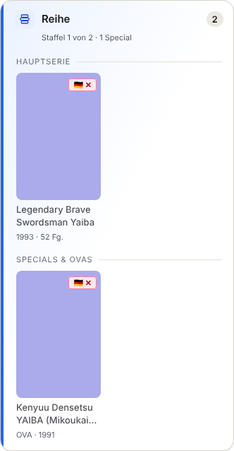
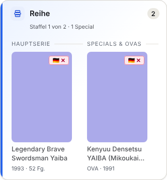
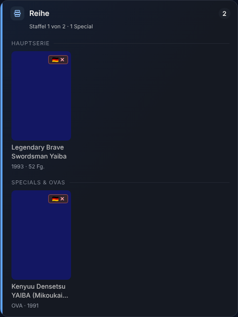
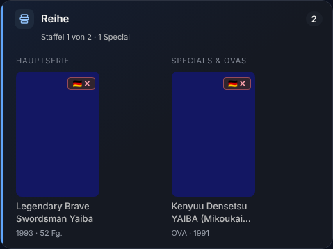
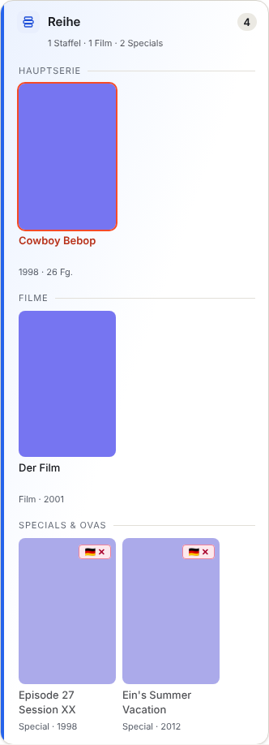
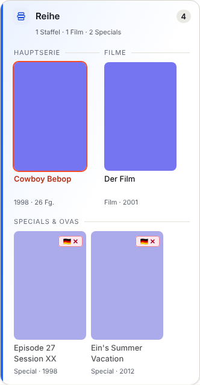
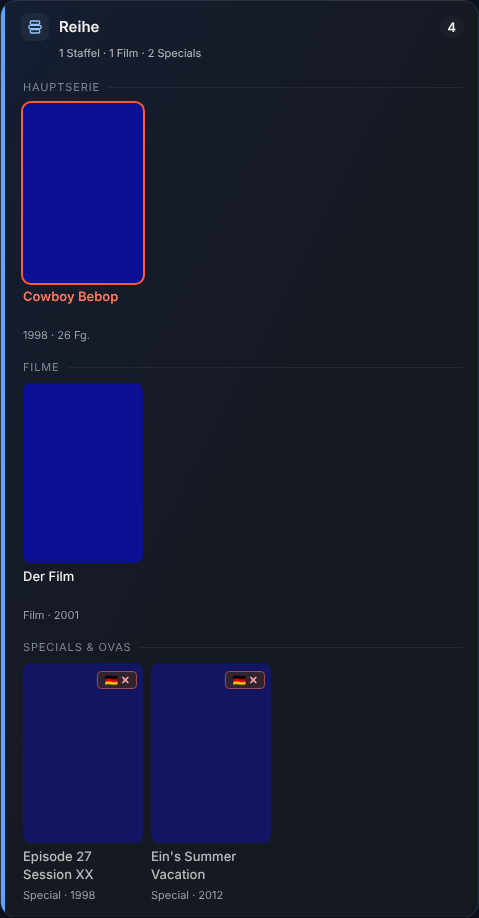
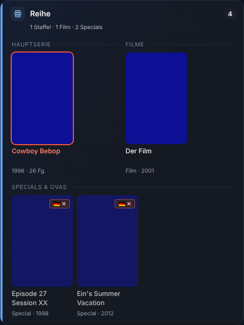

<!-- titel: feat(detail): Reihe-Gruppen mit einem Titel nebeneinander -->

## Ansatz

Im Kasten „Reihe" stehen Gruppen mit genau einem Teil (z. B. Yaiba: „Hauptserie" 1 Titel, „Specials & OVAs" 1 Titel) bisher untereinander, die rechte Hälfte blieb leer (Daniel, 26.11.2026 20:43). Jetzt paaren sich aufeinanderfolgende Einzel-Gruppen in Reihenfolge zu einer Zeile mit je 50 %. Gruppen mit mehr als einem Teil und eine übrig bleibende Einzel-Gruppe nehmen die volle Breite. Die Reihenfolge der Gruppen bleibt, die Überschrift steht je Gruppe über ihrer Spalte, die Cover-Breite ist unverändert (bei schmaler Spalte wischt die Spur wie bisher).

Die Paarung ist eine reine Funktion (`gruppenZeilen`); `reihenInhalt` legt je Zeile ein zweispaltiges Raster (`grid-cols-2`, `min-w-0` je Spalte). Die große Reihen-Übersicht (Gruppe über 12 Teile) ist unverändert.

## Geänderte Dateien

- `web/src/components/detail/reihen-zeilen.ts` (neu): `gruppenZeilen()`, Paarung der Einzel-Gruppen.
- `web/src/components/detail/reihen-inhalt.tsx`: rendert die Zeilen aus `gruppenZeilen` statt je Gruppe eine Zeile; `reihenInhalt` bleibt unter 80 Zeilen.
- `pipeline/check-reihen-zeilen.ts` (neu): Fixture-Test (Einzel+Einzel, +Mehrfach, drei Einzel, Einzel/Mehrfach/Einzel, vier Einzel, leer; gerendert: ein Raster, drei Spuren). Kein „heute".
- `tools/check-logic-liste.txt`: Eintrag für den neuen Test.
- `data/patchnotes/reihe-einzelne-gruppen-nebeneinander.yaml` (neu): „Kleine Reihen-Gruppen stehen nebeneinander".

## Geprüft

`check-reihen-zeilen`, `check-reihen-spur`, `check-reihen-uebersicht` grün, `npx tsc --noEmit -p .` Exit 0, `check:umfang` in Ordnung, `design-klassen` ohne neue Altklassen, eslint auf den berührten Dateien ohne Fund. Bundle: Einstieg 425,39 kB (vor und nach, identisch; die Komponente liegt im Panel-Chunk).

## Bilder (Playwright, Desktop 1100 px und 375 px, hell und dunkel)

Yaiba (177476): Vorher / Nachher
 
 

Cowboy Bebop (1: Hauptserie 1, Filme 1, Specials 2 = Einzel + Einzel + Mehrfach): Vorher / Nachher
 
 

Weitere Varianten (hell/dunkel × 375/1100) liegen im Ordner `bilder/`.

🤖 Generated with [Claude Code](https://claude.com/claude-code)
